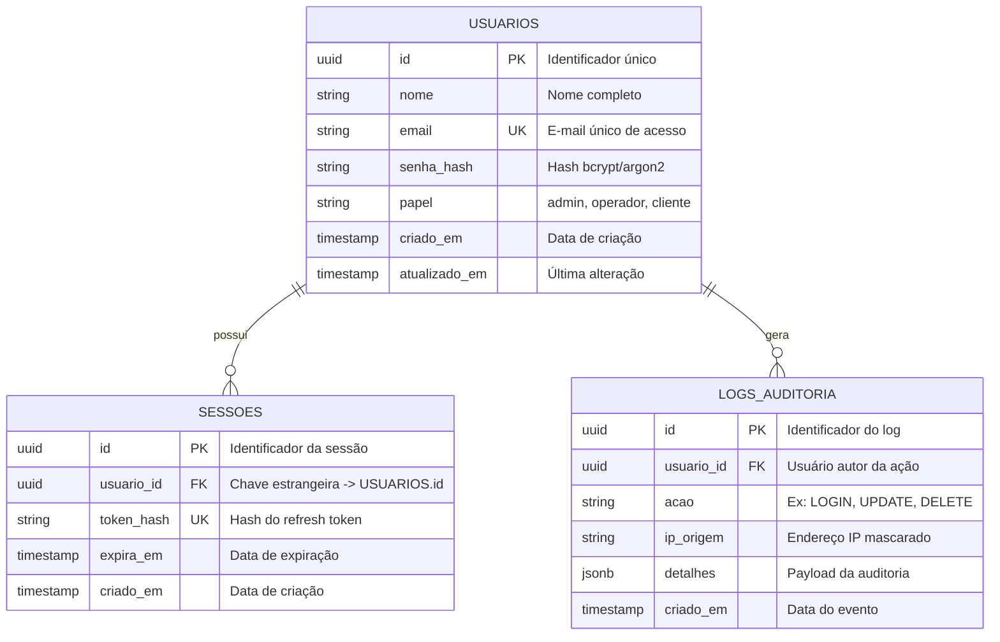

# 🗄️ Modelagem de Dados & Diagrama Entidade-Relacionamento (DER) - FTN DevsIA

Este documento é mantido sob custódia rigorosa do **`@BackendDev`** e homologado pelo **`@TechLead`**. Ele representa a modelagem viva do banco de dados oficial do projeto (**`PostgreSQL 18.6`**).

---

## 🚨 Regra de Ouro da Documentação Viva de Banco de Dados

> **REGRA INEGOCIÁVEL:** A cada nova *Migration* criada (`npm run db:migrate`), o desenvolvedor back-end é **OBRIGADO** a atualizar este arquivo no **MESMO PULL REQUEST**.
> É expressamente proibido subir alterações de schema de banco sem refletir as novas tabelas, relacionamentos e colunas no diagrama Mermaid abaixo.

---

## 📊 1. Diagrama Entidade-Relacionamento (DER Mermaid)

---

## 📚 2. Dicionário de Dados & Tabelas

### 2.1. Tabela: `USUARIOS`
* **Descrição:** Armazena as credenciais e o perfil dos usuários do sistema.
* **Índices:**
  * `idx_usuarios_email`: B-Tree em `email` (Unique).

| Coluna | Tipo | Nulo | Chave | Descrição |
| :--- | :--- | :---: | :---: | :--- |
| `id` | `UUID` | Não | PK | Chave primária gerada via `gen_random_uuid()` |
| `nome` | `VARCHAR(150)` | Não | - | Nome completo do usuário |
| `email` | `VARCHAR(255)` | Não | UK | E-mail corporativo único |
| `senha_hash` | `VARCHAR(255)` | Não | - | Hash criptográfico seguro |
| `papel` | `VARCHAR(50)` | Não | - | Papel RBAC de permissão |
| `criado_em` | `TIMESTAMPTZ` | Não | - | Data de registro |
| `atualizado_em` | `TIMESTAMPTZ` | Não | - | Data da última alteração |

---

### 2.2. Tabela: `SESSOES`
* **Descrição:** Controle de tokens ativos e revogação de acessos.
* **Índices:**
  * `idx_sessoes_usuario_id`: B-Tree em `usuario_id`.
  * `idx_sessoes_token`: B-Tree em `token_hash` (Unique).

---

## 📜 3. Histórico de Migrations Homologadas

| Versão | Arquivo de Migration | Autor | Descrição da Alteração |
| :---: | :--- | :--- | :--- |
| `001` | `20261101_001_create_usuarios.sql` | `@BackendDev` | Criação da tabela base de usuários e RBAC |
| `002` | `20261101_002_create_sessoes.sql` | `@BackendDev` | Estrutura de refresh tokens e expiração |
