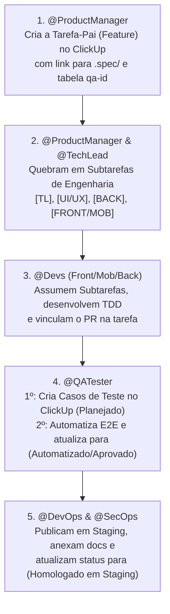

# 📋 Integração & Governança no ClickUp - FTN DevsIA

Este documento define a governança de gestão de demandas, rastreabilidade ponta a ponta e ciclo de vida de tarefas no **ClickUp** para o time FTN DevsIA.

---

## 🎯 1. Estrutura Padrão no ClickUp

Para garantir que tudo passe pelo ClickUp de forma organizada e auditável, o projeto adota a seguinte hierarquia:

```text
Workspace: FTN DevsIA
└── Space: [Nome do Projeto]
    └── Folder: [Versão / Módulo Atual (ex: v1.0 - Core)]
        ├── 📋 1. Features & Épicos       (Gerenciado pelo @ProductManager)
        ├── 🛠️ 2. Tarefas Técnicas       (Gerenciado por @TechLead e @Devs)
        ├── 🧪 3. Casos de Teste & QA     (Gerenciado pelo @QATester)
        └── 🚀 4. Releases & Deploys     (Gerenciado por @DevOps e @SecOps)
```

---

## 🔄 2. O Ciclo de Vida da Demanda no ClickUp



---

## 📑 3. Padrão de Cards e Subtarefas

### 3.1. Tarefa-Pai (Feature / Épico)
* **Criador:** `@ProductManager`
* **Nome da Tarefa:** `[FEATURE] - [Nome da Funcionalidade]` (ex: `[FEATURE] - Autenticação Biométrica e Login`)
* **Descrição Obrigatória:**
  * **Objetivo de Negócio:** Resumo do valor para o usuário.
  * **Link da Especificação:** `.spec/features/[feature].md`
  * **Tabela Mestra de qa-id:** IDs congelados para os testes.
  * **Documentação Aprovada:** Link para `docs/documentacao_projeto/`

### 3.2. Quebra de Subtarefas Técnicas (Engenharia)
O `@ProductManager` e o `@TechLead` dividem a Feature nas seguintes subtarefas padronizadas:

1. `[TL] Modelagem de Dados & Arquitetura`
   * Responsável: `@TechLead`
   * Entrega: `.spec/arquitetura.md` e contratos de API vinculados.
2. `[UI/UX] Design System, Estados & WCAG`
   * Responsável: `@UIUXDesigner`
   * Entrega: `docs/design/design_system.md` e telas de fallback anti-crash (`qa-id="btn-error-retry"`).
3. `[BACK] Migrations & APIs Seguras (TDD ≥90%)`
   * Responsável: `@BackendDev`
   * Entrega: PR aberto para `develop` com Níveis 1, 3 e 4 da Pirâmide de Testes.
4. `[FRONT/MOB] Telas & Componentes (TDD ≥90%)`
   * Responsável: `@FrontendDev` ou `@MobileDev`
   * Entrega: PR aberto para `develop` com Níveis 1 e 2 da Pirâmide de Testes e injeção dos `qa-id`s.

---

## 🧪 4. Casos de Teste no ClickUp (QA Rastreável)

O `@QATester` é o gestor dos Casos de Teste vinculados à Feature:

1. **Etapa 1 - Criação e Planejamento:**
   * O QA cria os cards ou itens de checklist de Casos de Teste (ex: `CT-001 - Login Caminho Feliz`, `CT-002 - Senha Incorreta`, `CT-003 - Fallback btn-error-retry`).
   * Anexa o link para `docs/testes/casos_de_teste/[feature].md`.
   * Status no ClickUp: **`📝 Casos de Teste Planejados`**.

2. **Etapa 2 - Automação e Homologação:**
   * O QA codifica as automações E2E (Zero XPath).
   * Executa a suíte na esteira de CI.
   * Se aprovado, atualiza o status dos casos de teste para: **`🤖 Automatizado & Aprovado`**.
   * Se houver falha, registra o bug vinculado com a tag `🐛 Bug de QA` e rejeita o PR.

---

## 🚀 5. Deploys, Documentação e Segurança

* **`@DevOps`:**
  * Ao realizar o deploy no Docker Swarm, comenta na tarefa da Feature no ClickUp o link público seguro de staging (`://dominio.com.br`) e atualiza o status para **`🌐 Disponível em Staging`**.
* **`@SecOps`:**
  * Anexa o link do relatório de conformidade [`docs/auditoria/security-report.md`](file:///Users/vitorfantin/.gemini/antigravity/worktrees/team-ftn-devs-ia/analise_designacao_tarefas_especificas/docs/auditoria/security-report.md) e marca a Feature como **`🛡️ SecOps Homologado`**.

---

## 🔐 6. Variáveis de Ambiente (Zero-Secret Leak)

Para scripts de sincronização automática com a API do ClickUp (REST v2), configure no seu arquivo local `.env` (nunca no chat nem no Git):

```env
CLICKUP_API_TOKEN=pk_seu_token_aqui
CLICKUP_TEAM_ID=12345678
CLICKUP_SPACE_ID=87654321
CLICKUP_FEATURES_LIST_ID=11112222
CLICKUP_TASKS_LIST_ID=33334444
CLICKUP_TESTS_LIST_ID=55556666
```
